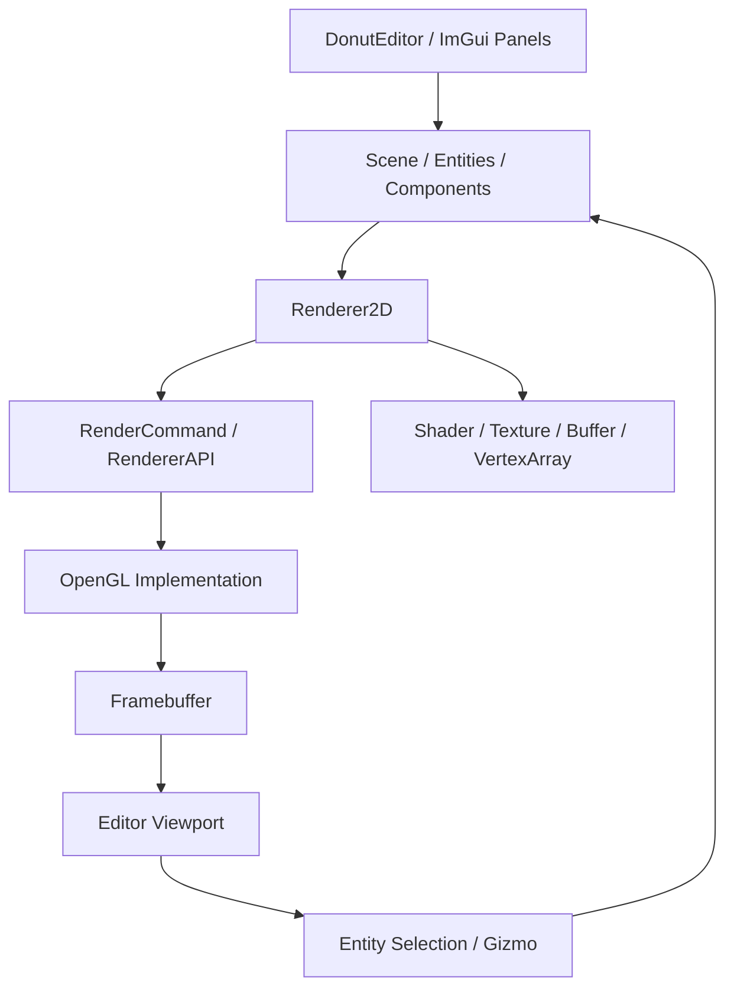
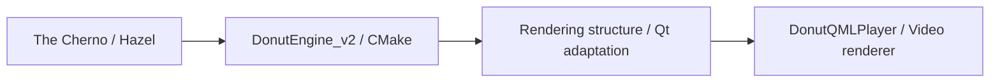

# DonutEngine_v2

**日本語** | [简体中文](README.zh-CN.md)

**The Chernoのゲームエンジン開発シリーズを参考に、C++・OpenGLで取り組んだ、2Dレンダラーとシーンエディターの学習プロジェクトです。**

[Hazel](https://github.com/TheCherno/Hazel)の設計・実装を追いながら、アプリケーションの基盤、描画リソース、シーン、エディターの関係を学び、ビルド構成をCMakeに整理しました。

さらに、このプロジェクトで学んだ描画層を整理・簡略化し、[DonutQMLPlayer](https://github.com/Seppura-y/DonutQMLPlayer)の動画レンダラーへ応用しました。**エンジンの構造を理解し、用途に合わせて別のアプリケーションへ組み込むこと**まで取り組んでいます。


## 開発の位置付け

エンジンの基本設計と多くの機能は、The ChernoのチュートリアルとHazelを参考にしています。このリポジトリーでは、その学習実装に加えて、CMakeによるプロジェクトの整理と、後続のQtアプリケーションで使うための描画構造の理解に取り組みました。

| 取り組み | 内容 |
|---|---|
| エンジンの学習 | ウィンドウ、イベント、レイヤー、レンダラー、シーン、エディターの役割を理解する |
| ビルド構成の整理 | エンジン、エディター、C#スクリプトのターゲットと依存関係をCMakeでまとめる |
| 描画層の応用 | シェーダー、テクスチャー、バッファー、描画コマンドの構成を動画表示向けに整理する |
| Qtへの適用 | DonutQMLPlayerでQtのOpenGL APIと描画ライフサイクルに合わせて組み込む |

## 主な実装内容

| 分類 | 内容 |
|---|---|
| アプリケーション基盤 | Application、Window、Layer／LayerStack、入力・イベント処理 |
| OpenGL描画 | 頂点・インデックス・Uniform Buffer、Vertex Array、シェーダー、テクスチャー、Framebuffer |
| 2Dレンダラー | 矩形、スプライト、円、線、テキストの描画、バッチ処理、描画統計 |
| シーン | EnTTを使ったEntity／Component管理、カメラ、Transform、描画用Component |
| エディター | Dear ImGuiによるビューポート、シーン階層、プロパティ編集、コンテンツブラウザー |
| 編集操作 | ImGuizmoによる移動・回転・拡大縮小、Entity IDを用いた画面上の選択 |
| 保存と読み込み | YAMLによるシーン・プロジェクトのシリアライズ |
| 実行処理 | 編集／再生／シミュレーションの切り替え、Box2D、MonoによるC#スクリプト連携 |

## 描画とエディターの構成



### 描画リソースと呼び出しの分離

`Renderer2D`から描画コマンドを発行し、`RenderCommand`と`RendererAPI`を通してOpenGL実装へつなぐ構成です。バッファー、テクスチャー、シェーダーなどもクラスに分け、生成・更新・使用・解放の役割を整理しています。

この分離を理解したことが、後にウィンドウ基盤をQtへ変えて描画層を利用する際の土台になりました。

### バッチ処理と描画統計

矩形などの頂点情報をCPU側のバッファーへ蓄積し、描画時にGPU側へ転送する構成です。テクスチャースロットやバッファーの上限に応じてバッチを区切り、Draw Call数や矩形数を記録します。

描画を一件ずつ呼び出す処理と、まとめて送る処理の違いを、データの持ち方と実行順序から学びました。

### オフスクリーン描画とシーン操作

シーンをFramebufferへ描画し、その結果をエディターのビューポートに表示します。色の出力に加えてEntity IDを扱い、マウス位置に対応するIDを読み取って選択へつなげています。

選択したEntityは、シーン階層パネルやImGuizmoから操作します。表示、選択、Componentの変更がどのようにつながるかを確認できる構成です。

## DonutQMLPlayerへの応用

このプロジェクトの描画構造を基に、動画表示に必要な部分を整理し、[DonutQMLPlayer](https://github.com/Seppura-y/DonutQMLPlayer)へ組み込みました。



| エンジンで扱った構造 | プレーヤーでの適用 |
|---|---|
| GLFWとGLADを使うウィンドウ・OpenGL環境 | Qt Quickの`QQuickItem`と`QOpenGLFunctions`系APIへ適合 |
| `RenderCommand`／`RendererAPI` | `DonutRenderCommand`／`DonutGLRendererApi`として描画呼び出しを整理 |
| Buffer／VertexArray／Shader／Textureのラッパー | QtのOpenGL呼び出しを使う描画リソースクラスへ整理 |
| `Renderer2D`の描画構成 | `DonutSceneRenderer`で動画と矩形の描画を扱う構成へ応用 |
| カメラ・座標変換 | 動画の回転、位置、拡大率の制御に利用 |
| 画像テクスチャーの描画 | デコードした動画フレームのY・U・Vデータをテクスチャーとして更新 |

動画側では、継続的に届くフレームの更新と、Qt Quickの描画タイミングへの接続が必要になります。`DonutScene`を`QQuickItem`として構成し、動画データと描画層をつなぎました。

移した対象は動画用途に整理した描画層です。シーンエディター、物理演算、C#スクリプト等は、DonutQMLPlayerの構成には含めていません。

### 対応するコード

| 確認する内容 | DonutEngine_v2 | DonutQMLPlayer |
|---|---|---|
| 描画コマンド | [render_command.h](src/DonutEngine/src/renderer/render_command.h) | [donut_render_command.h](https://github.com/Seppura-y/DonutQMLPlayer/blob/master/src/renderer/donut_render_command.h) |
| バッファー | [opengl_buffers.cpp](src/DonutEngine/src/platform/opengl/opengl_buffers.cpp) | [opengl_vertex_buffer.cpp](https://github.com/Seppura-y/DonutQMLPlayer/blob/master/src/renderer/opengl_vertex_buffer.cpp) |
| 描画の組み立て | [renderer_2d.cpp](src/DonutEngine/src/renderer/renderer_2d.cpp) | [donut_scene_renderer.cpp](https://github.com/Seppura-y/DonutQMLPlayer/blob/master/src/renderer/donut_scene_renderer.cpp) |
| アプリケーションとの接続 | [application.cpp](src/DonutEngine/src/core/application.cpp) | [donut_scene.cpp](https://github.com/Seppura-y/DonutQMLPlayer/blob/master/src/player/donut_scene.cpp) |

## ソースコードの入口

| ディレクトリー／ファイル | 役割 |
|---|---|
| [src/DonutEngine/src/core/](src/DonutEngine/src/core/) | アプリケーション、ウィンドウ抽象、レイヤー |
| [src/DonutEngine/src/renderer/](src/DonutEngine/src/renderer/) | レンダラーとリソースのインターフェース |
| [src/DonutEngine/src/platform/opengl/](src/DonutEngine/src/platform/opengl/) | OpenGLによる具体的な実装 |
| [src/DonutEngine/src/scene/](src/DonutEngine/src/scene/) | Entity、Component、シーン保存・読み込み |
| [src/DonutEditor/src/editor_layer.cpp](src/DonutEditor/src/editor_layer.cpp) | エディターの描画、選択、実行状態の切り替え |
| [src/DonutEditor/src/panels/](src/DonutEditor/src/panels/) | シーン階層とコンテンツブラウザー |
| [src/DonutScripts/](src/DonutScripts/) | C#側のコアAPIとサンプルスクリプト |

描画層を確認する場合は、`Renderer2D`→`RenderCommand`→OpenGL実装の順に読むと、処理の分担を追いやすくなっています。

## 使用技術

| 技術 | 用途 |
|---|---|
| C++17 / CMake 3.22以上 | エンジン、エディター、ビルド構成 |
| OpenGL / GLFW / GLAD / GLM | 描画、ウィンドウ・入力、API読み込み、行列 |
| Dear ImGui / ImGuizmo | エディターUI、Transform操作 |
| EnTT / yaml-cpp | Entity／Component、シリアライズ |
| Box2D | 2D物理演算との連携 |
| Mono / C# | スクリプトの実行とC++側APIとの接続 |
| shaderc / SPIRV-Cross | シェーダーのコンパイル・変換 |
| FreeType / msdfgen / msdf-atlas-gen | フォント・テキスト描画 |
| spdlog / stb_image | ログ、画像読み込み |

## ビルドと実行

現在のメイン構成はWindows・Visual Studio向けです。ルートのCMakeから`DonutEngine`、`DonutEditor`、`DonutScripts`を構成します。実行対象は`DonutEditor`です。

### 事前準備

リポジトリーには依存ファイルと実行素材の一部のみを収録しています。[エンジン側のCMake](src/DonutEngine/CMakeLists.txt)と[エディター側のCMake](src/DonutEditor/CMakeLists.txt)に記載された配置先へ、必要なファイルを用意してください。

- `src/DonutEngine/dependencies/`内のGLFW、GLAD、ImGui、GLM、EnTT、yaml-cpp、Box2D、Mono、ImGuizmo、フォント関連ライブラリー等。
- `lib/`内のリンク用ライブラリーと、構成に対応するMono等のファイル。
- `VULKAN_SDK`から参照するshaderc／SPIRV-Crossのヘッダーとライブラリー。現在の描画バックエンドはOpenGLです。
- C#プロジェクトが指定する.NET Framework 4.7.2のビルド環境。
- `bin/`を基準として読み込むシェーダー、テクスチャー、フォント、プロジェクト／シーンなどの実行素材。

エディターのリンク設定にはDebug用のシェーダーライブラリー名が含まれます。使用するSDKのファイル名、Debug／Release、x64、ランタイムの設定を合わせてください。

### コマンド例

依存ファイルを配置した後、Visual Studio 2022向けに構成する例です。

```powershell
cmake -S . -B build -G "Visual Studio 17 2022" -A x64
cmake --build build --config Debug --target DonutEditor
```

実行ファイルの出力先とVisual Studioの作業ディレクトリーは`bin/`を指定しています。必要な素材とランタイムを配置してから起動します。

```powershell
Push-Location ./bin
./DonutEditor.exe
Pop-Location
```

## 画面例


## 参考・関連プロジェクト

- **The Chernoのゲームエンジン開発シリーズ／[Hazel](https://github.com/TheCherno/Hazel)**：エンジンとエディターの設計・実装の学習元。
- **[DonutQMLPlayer](https://github.com/Seppura-y/DonutQMLPlayer)**：本プロジェクトの描画構造を整理し、Qtベースの動画レンダラーへ応用したプロジェクト。

学習元への参照を明確にしたうえで、ビルドの整理と、学んだ構造を別の用途に適用する過程を紹介しています。
