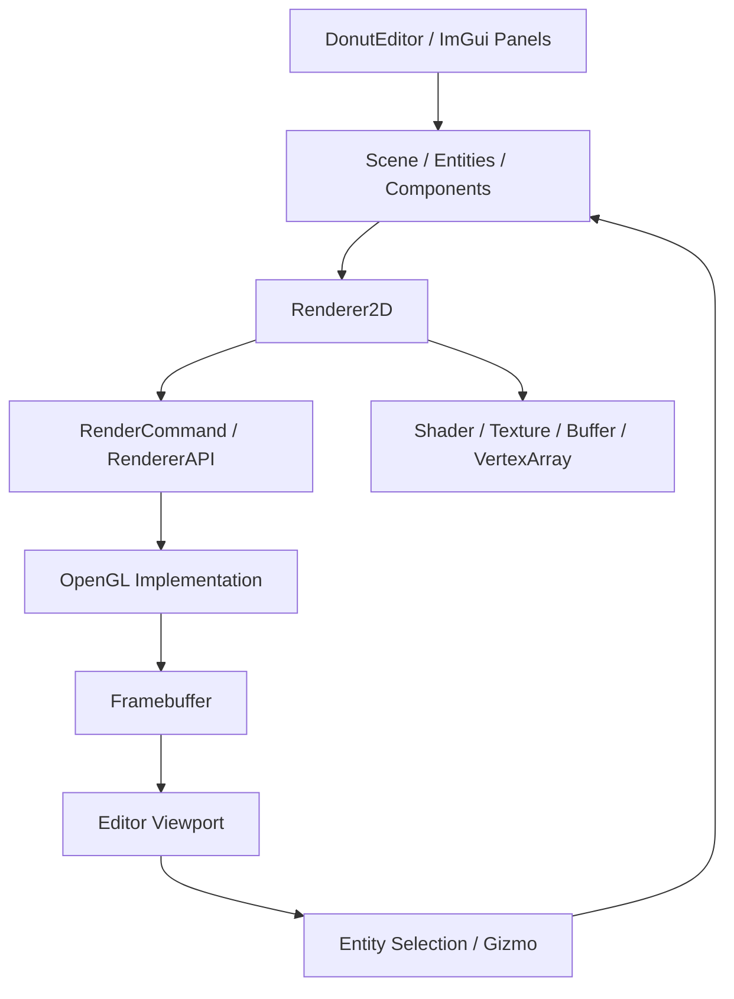
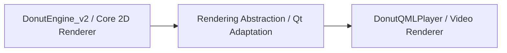

# DonutEngine_v2

[日本語](README.md) | **简体中文**

**基于 C++17 与 OpenGL 实现的 2D 批量渲染器（Batch Renderer）及 Dear ImGui 场景编辑器。**

基于模块化游戏引擎架构，整合应用程序框架、OpenGL 渲染资源抽象、ECS 场景管理与可视化编辑器，并通过 CMake 组织多目标构建体系。

在此基础上，进一步抽离本项目的核心渲染层，移植并应用到 [DonutQMLPlayer](https://github.com/Seppura-y/DonutQMLPlayer) 的自定义视频渲染器中，打通了**底层渲染抽象到跨 UI 框架（Qt Quick）集成**的完整链路。


## 设计主线与工程应用

本仓库在参考 [Hazel](https://github.com/TheCherno/Hazel) 等引擎架构的基础上，重点完成了 CMake 多模块构建体系化，以及面向外部应用复用的 OpenGL 渲染层解耦设计。

| 核心工作 | 说明 |
|---|---|
| 引擎分层设计 | 解耦窗口抽象、事件分发、Layer 栈、渲染器、ECS 场景与编辑器的职责 |
| 构建体系整理 | 使用 CMake 统一组织引擎核心、编辑器、C# 脚本目标及其依赖关系 |
| 渲染层通用化 | 将着色器、纹理、缓冲区与绘制命令独立封装，便于跨项目裁剪复用 |
| Qt 平台移植 | 在 DonutQMLPlayer 中适配 Qt OpenGL API 与 Scene Graph 渲染生命周期 |

## 主要实现

| 分类 | 内容 |
|---|---|
| 应用程序基础 | Application、Window、Layer／LayerStack、输入与事件处理 |
| OpenGL 绘制 | 顶点、索引、Uniform Buffer、Vertex Array、着色器、纹理、Framebuffer |
| 2D 渲染器 | 矩形、精灵、圆、线和文字绘制，批处理渲染（Batch Rendering）与绘制统计 |
| 场景 | 基于 EnTT 的 Entity／Component 管理、相机、Transform、绘制用 Component |
| 编辑器 | 基于 Dear ImGui 的视口、场景层级、属性编辑与内容浏览器 |
| 编辑操作 | 使用 ImGuizmo 进行移动、旋转和缩放，通过 Entity ID 完成屏幕拾取 |
| 保存与读取 | 使用 YAML 序列化场景和项目 |
| 运行处理 | 编辑／播放／模拟模式切换、Box2D 物理引擎、基于 Mono 的 C# 脚本交互 |

## 渲染与编辑器结构



### 分离渲染资源与绘制调用

`Renderer2D` 发出绘制命令，通过 `RenderCommand` 和 `RendererAPI` 连接到 OpenGL 实现。缓冲区、纹理和着色器等分别封装为资源类，明确创建、更新、绑定与释放的生命周期。

将窗口管理与 OpenGL 调用解耦的设计，为后续把底层窗口从 GLFW 替换为 Qt Quick 并直接复用渲染层奠定了基础。

### 批处理渲染与绘制统计

将矩形等图元的顶点信息累积到 CPU 端缓冲区，绘制时一次性批量提交至 GPU。根据纹理槽和缓冲区上限自动划分批次，并实时统计 Draw Call 数量和图元数量，从而降低逐对象发起绘制调用的驱动开销。

### 离屏渲染与场景操作

将场景离屏绘制到 Framebuffer 并在编辑器视口中展示；除颜色附件外，同步输出 Entity ID 附件，通过读取鼠标坐标对应的像素 ID 实现精准实体拾取，并与层级面板及 ImGuizmo 变换控件联动。

## 在 DonutQMLPlayer 中的应用

基于本项目的核心渲染结构，抽离视频显示所需组件并接入 [DonutQMLPlayer](https://github.com/Seppura-y/DonutQMLPlayer)。



| 引擎构建的结构 | 在播放器中的应用 |
|---|---|
| 基于 GLFW 和 GLAD 的窗口、OpenGL 环境 | 适配到 Qt Quick 的 `QQuickItem` 与 `QOpenGLFunctions` 系列 API |
| `RenderCommand`／`RendererAPI` | 整理为 `DonutRenderCommand`／`DonutGLRendererApi`，组织绘制调用 |
| Buffer／VertexArray／Shader／Texture 封装 | 适配为基于 Qt OpenGL 上下文的渲染资源类 |
| `Renderer2D` 的绘制结构 | 在 `DonutSceneRenderer` 中负责视频帧与图元绘制 |
| 相机与坐标变换 | 控制视频画面的旋转、平移与缩放 |
| 纹理动态更新 | 将解码视频帧的 Y／U／V 平面数据持续上传至 GPU 纹理 |

视频端需持续更新解码帧并对齐 Qt Quick 渲染线程时机，项目通过继承 `QQuickItem` 实现 `DonutScene`，完成解码数据流与自定义渲染层的桥接（已剥离场景编辑器、物理模拟与 C# 脚本等无关模块）。

### 对应源码

| 内容 | DonutEngine_v2 | DonutQMLPlayer |
|---|---|---|
| 绘制命令 | [render_command.h](src/DonutEngine/src/renderer/render_command.h) | [donut_render_command.h](https://github.com/Seppura-y/DonutQMLPlayer/blob/master/src/renderer/donut_render_command.h) |
| 缓冲区 | [opengl_buffers.cpp](src/DonutEngine/src/platform/opengl/opengl_buffers.cpp) | [opengl_vertex_buffer.cpp](https://github.com/Seppura-y/DonutQMLPlayer/blob/master/src/renderer/opengl_vertex_buffer.cpp) |
| 绘制流程组织 | [renderer_2d.cpp](src/DonutEngine/src/renderer/renderer_2d.cpp) | [donut_scene_renderer.cpp](https://github.com/Seppura-y/DonutQMLPlayer/blob/master/src/renderer/donut_scene_renderer.cpp) |
| 与应用连接 | [application.cpp](src/DonutEngine/src/core/application.cpp) | [donut_scene.cpp](https://github.com/Seppura-y/DonutQMLPlayer/blob/master/src/player/donut_scene.cpp) |

## 源码阅读入口

| 目录／文件 | 职责 |
|---|---|
| [src/DonutEngine/src/core/](src/DonutEngine/src/core/) | 应用程序、窗口抽象与 Layer |
| [src/DonutEngine/src/renderer/](src/DonutEngine/src/renderer/) | 渲染器和资源抽象接口 |
| [src/DonutEngine/src/platform/opengl/](src/DonutEngine/src/platform/opengl/) | OpenGL 后端具体实现 |
| [src/DonutEngine/src/scene/](src/DonutEngine/src/scene/) | Entity、Component、场景序列化 |
| [src/DonutEditor/src/editor_layer.cpp](src/DonutEditor/src/editor_layer.cpp) | 编辑器绘制、拾取与运行状态切换 |
| [src/DonutEditor/src/panels/](src/DonutEditor/src/panels/) | 场景层级与内容浏览器面板 |
| [src/DonutScripts/](src/DonutScripts/) | C# 核心 API 与脚本绑定 |

阅读渲染层时，可按 `Renderer2D` → `RenderCommand` → OpenGL 实现的顺序追踪职责划分。

## 技术栈

| 技术 | 用途 |
|---|---|
| C++17 / CMake 3.22 及以上 | 引擎、编辑器和构建配置 |
| OpenGL / GLFW / GLAD / GLM | 绘制、窗口与输入、API 加载、矩阵运算 |
| Dear ImGui / ImGuizmo | 编辑器 UI、Transform 操作控件 |
| EnTT / yaml-cpp | Entity／Component 管理、场景序列化 |
| Box2D | 2D 物理模拟 |
| Mono / C# | 脚本执行及与 C++ API 绑定 |
| shaderc / SPIRV-Cross | 着色器编译与反射转换 |
| FreeType / msdfgen / msdf-atlas-gen | 字体图集与文字渲染 |
| spdlog / stb_image | 日志记录与纹理图片加载 |

## 构建与运行

当前主要构建配置面向 Windows 和 Visual Studio。根目录 CMake 组织 `DonutEngine`、`DonutEditor`、`DonutScripts` 三个目标，可执行入口为 `DonutEditor`。

### 准备依赖

仓库仅收录核心源码及部分配置，请根据[引擎 CMake](src/DonutEngine/CMakeLists.txt) 与[编辑器 CMake](src/DonutEditor/CMakeLists.txt) 中的路径准备依赖与资源：

- `src/DonutEngine/dependencies/` 中的 GLFW、GLAD、ImGui、GLM、EnTT、yaml-cpp、Box2D、Mono、ImGuizmo 和字体相关库等。
- `lib/` 中的链接库，以及与构建配置对应的 Mono 运行库。
- 通过 `VULKAN_SDK` 引用的 shaderc／SPIRV-Cross 头文件与库（当前图形后端为 OpenGL）。
- C# 脚本工程所需的 .NET Framework 4.7.2 构建环境。
- 以 `bin/` 为基准目录读取的着色器、纹理、字体、示例工程与场景资产。

### 命令示例

```powershell
cmake -S . -B build -G "Visual Studio 17 2022" -A x64
cmake --build build --config Debug --target DonutEditor
```

可执行文件输出目录与调试工作目录均指定为 `bin/`：

```powershell
Push-Location ./bin
./DonutEditor.exe
Pop-Location
```

## 界面示例


## 关联项目与参考架构

- **[DonutQMLPlayer](https://github.com/Seppura-y/DonutQMLPlayer)**：抽离本项目 OpenGL 渲染层并移植为 Qt Quick 视频渲染器的应用项目。
- **[Hazel](https://github.com/TheCherno/Hazel)**：引擎基础分层与编辑器架构设计参考。
