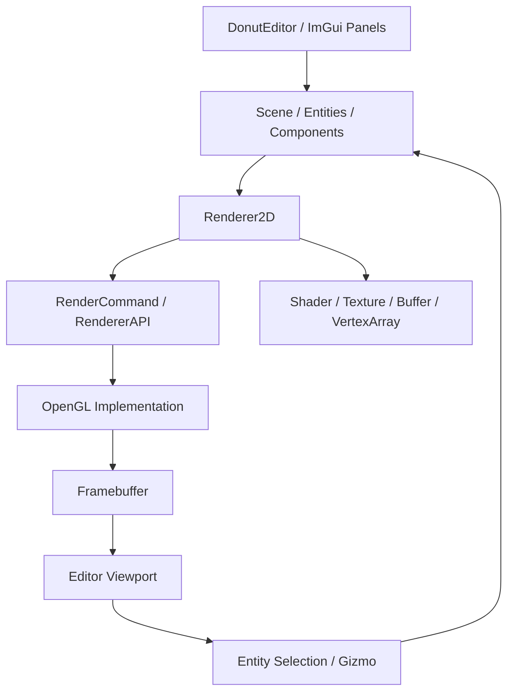
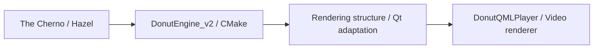

# DonutEngine_v2

[日本語](README.md) | **简体中文**

**参考 The Cherno 游戏引擎开发系列，使用 C++ 与 OpenGL 实践的 2D 渲染器及场景编辑器学习项目。**

跟随 [Hazel](https://github.com/TheCherno/Hazel) 的设计与实现，学习应用程序基础、渲染资源、场景和编辑器之间的关系，并将构建方式整理为 CMake。

进一步将本项目中学习的渲染层整理、简化，应用到 [DonutQMLPlayer](https://github.com/Seppura-y/DonutQMLPlayer) 的视频渲染器中。实践范围包括**理解引擎结构，并根据用途调整后接入另一款应用**。


## 项目定位

引擎的基础设计与许多功能参考 The Cherno 教程和 Hazel。本仓库在学习实现的基础上，使用 CMake 整理项目，并理解用于后续 Qt 应用的渲染结构。

| 实践内容 | 说明 |
|---|---|
| 引擎学习 | 理解窗口、事件、Layer、渲染器、场景和编辑器的职责 |
| 构建整理 | 使用 CMake 组织引擎、编辑器、C# 脚本目标及其依赖关系 |
| 渲染层应用 | 将着色器、纹理、缓冲区与绘制命令按视频显示需求进行整理 |
| Qt 适配 | 在 DonutQMLPlayer 中结合 Qt OpenGL API 与绘制生命周期接入渲染层 |

## 主要实现

| 分类 | 内容 |
|---|---|
| 应用程序基础 | Application、Window、Layer／LayerStack、输入与事件处理 |
| OpenGL 绘制 | 顶点、索引、Uniform Buffer、Vertex Array、着色器、纹理、Framebuffer |
| 2D 渲染器 | 矩形、精灵、圆、线和文字绘制，批处理与绘制统计 |
| 场景 | 基于 EnTT 的 Entity／Component 管理、相机、Transform、绘制用 Component |
| 编辑器 | 基于 Dear ImGui 的视口、场景层级、属性编辑与内容浏览器 |
| 编辑操作 | 使用 ImGuizmo 进行移动、旋转和缩放，通过 Entity ID 完成屏幕拾取 |
| 保存与读取 | 使用 YAML 序列化场景和项目 |
| 运行处理 | 编辑／播放／模拟模式切换、Box2D、基于 Mono 的 C# 脚本交互 |

## 渲染与编辑器结构



### 分离渲染资源与绘制调用

`Renderer2D` 发出绘制命令，通过 `RenderCommand` 和 `RendererAPI` 连接到 OpenGL 实现。缓冲区、纹理和着色器等也分别封装为类，整理创建、更新、使用与释放的职责。

对这一分层的理解，为之后将窗口基础替换为 Qt 并复用渲染层提供了基础。

### 批处理与绘制统计

将矩形等对象的顶点信息积累到 CPU 端缓冲区，绘制时传输到 GPU。根据纹理槽和缓冲区上限划分批次，并记录 Draw Call 数量和矩形数量。

通过数据组织和执行顺序，学习逐个发起绘制调用与批量提交之间的区别。

### 离屏渲染与场景操作

将场景绘制到 Framebuffer，并在编辑器视口中显示结果。除了颜色输出，还处理 Entity ID，读取鼠标位置对应的 ID 来完成选择。

选中的 Entity 可以通过场景层级面板和 ImGuizmo 操作，便于观察显示、选择与 Component 修改之间的关系。

## 在 DonutQMLPlayer 中的应用

基于本项目的渲染结构，整理视频显示所需的部分，接入 [DonutQMLPlayer](https://github.com/Seppura-y/DonutQMLPlayer)。



| 引擎中的结构 | 在播放器中的应用 |
|---|---|
| 基于 GLFW 和 GLAD 的窗口、OpenGL 环境 | 适配到 Qt Quick 的 `QQuickItem` 与 `QOpenGLFunctions` 系列 API |
| `RenderCommand`／`RendererAPI` | 整理为 `DonutRenderCommand`／`DonutGLRendererApi`，组织绘制调用 |
| Buffer／VertexArray／Shader／Texture 封装 | 整理为使用 Qt OpenGL 调用的渲染资源类 |
| `Renderer2D` 的绘制结构 | 在 `DonutSceneRenderer` 中处理视频和矩形绘制 |
| 相机与坐标变换 | 控制视频旋转、位置与缩放 |
| 图片纹理绘制 | 将解码视频帧的 Y／U／V 数据作为纹理持续更新 |

视频端需要持续更新接收到的帧，并连接 Qt Quick 的绘制时机。项目将 `DonutScene` 实现为 `QQuickItem`，连接视频数据与渲染层。

迁移的对象是根据视频用途整理的渲染层。场景编辑器、物理模拟和 C# 脚本等未纳入 DonutQMLPlayer。

### 对应源码

| 内容 | DonutEngine_v2 | DonutQMLPlayer |
|---|---|---|
| 绘制命令 | [render_command.h](src/DonutEngine/src/renderer/render_command.h) | [donut_render_command.h](https://github.com/Seppura-y/DonutQMLPlayer/blob/master/src/renderer/donut_render_command.h) |
| 缓冲区 | [opengl_buffers.cpp](src/DonutEngine/src/platform/opengl/opengl_buffers.cpp) | [opengl_vertex_buffer.cpp](https://github.com/Seppura-y/DonutQMLPlayer/blob/master/src/renderer/opengl_vertex_buffer.cpp) |
| 绘制流程组织 | [renderer_2d.cpp](src/DonutEngine/src/renderer/renderer_2d.cpp) | [donut_scene_renderer.cpp](https://github.com/Seppura-y/DonutQMLPlayer/blob/master/src/renderer/donut_scene_renderer.cpp) |
| 与应用连接 | [application.cpp](src/DonutEngine/src/core/application.cpp) | [donut_scene.cpp](https://github.com/Seppura-y/DonutQMLPlayer/blob/master/src/player/donut_scene.cpp) |

## 源码阅读入口

| 目录／文件 | 职责 |
|---|---|
| [src/DonutEngine/src/core/](src/DonutEngine/src/core/) | 应用程序、窗口抽象与 Layer |
| [src/DonutEngine/src/renderer/](src/DonutEngine/src/renderer/) | 渲染器和资源接口 |
| [src/DonutEngine/src/platform/opengl/](src/DonutEngine/src/platform/opengl/) | OpenGL 的具体实现 |
| [src/DonutEngine/src/scene/](src/DonutEngine/src/scene/) | Entity、Component、场景保存与读取 |
| [src/DonutEditor/src/editor_layer.cpp](src/DonutEditor/src/editor_layer.cpp) | 编辑器绘制、选择与运行状态切换 |
| [src/DonutEditor/src/panels/](src/DonutEditor/src/panels/) | 场景层级与内容浏览器 |
| [src/DonutScripts/](src/DonutScripts/) | C# 核心 API 与示例脚本 |

阅读渲染层时，可按 `Renderer2D` → `RenderCommand` → OpenGL 实现的顺序，了解各层的处理职责。

## 技术栈

| 技术 | 用途 |
|---|---|
| C++17 / CMake 3.22 及以上 | 引擎、编辑器和构建配置 |
| OpenGL / GLFW / GLAD / GLM | 绘制、窗口与输入、API 加载、矩阵 |
| Dear ImGui / ImGuizmo | 编辑器 UI、Transform 操作 |
| EnTT / yaml-cpp | Entity／Component、序列化 |
| Box2D | 2D 物理模拟 |
| Mono / C# | 脚本执行及与 C++ API 连接 |
| shaderc / SPIRV-Cross | 着色器编译与转换 |
| FreeType / msdfgen / msdf-atlas-gen | 字体与文字绘制 |
| spdlog / stb_image | 日志与图片读取 |

## 构建与运行

当前主要构建配置面向 Windows 和 Visual Studio。根目录 CMake 组织 `DonutEngine`、`DonutEditor`、`DonutScripts` 三个目标，运行目标为 `DonutEditor`。

### 准备依赖

仓库只包含部分依赖和运行素材。请根据[引擎 CMake](src/DonutEngine/CMakeLists.txt) 与[编辑器 CMake](src/DonutEditor/CMakeLists.txt) 中的路径准备所需文件。

- `src/DonutEngine/dependencies/` 中的 GLFW、GLAD、ImGui、GLM、EnTT、yaml-cpp、Box2D、Mono、ImGuizmo 和字体相关库等。
- `lib/` 中的链接库，以及与构建配置对应的 Mono 等文件。
- 通过 `VULKAN_SDK` 引用的 shaderc／SPIRV-Cross 头文件与库。当前渲染后端为 OpenGL。
- C# 项目指定的 .NET Framework 4.7.2 构建环境。
- 以 `bin/` 为基准读取的着色器、纹理、字体、项目和场景等运行素材。

编辑器链接配置包含 Debug 版本的着色器库名。请确保 SDK 文件名、Debug／Release、x64 和运行库配置相互匹配。

### 命令示例

准备好依赖后，以下命令使用 Visual Studio 2022 配置项目。

```powershell
cmake -S . -B build -G "Visual Studio 17 2022" -A x64
cmake --build build --config Debug --target DonutEditor
```

可执行文件输出目录与 Visual Studio 工作目录均指定为 `bin/`。放置所需素材和运行库后启动。

```powershell
Push-Location ./bin
./DonutEditor.exe
Pop-Location
```

## 界面示例


## 参考与关联项目

- **The Cherno 游戏引擎开发系列／[Hazel](https://github.com/TheCherno/Hazel)**：引擎与编辑器设计、实现的学习来源。
- **[DonutQMLPlayer](https://github.com/Seppura-y/DonutQMLPlayer)**：整理本项目的渲染结构，并应用为 Qt 视频渲染器的项目。

在明确学习来源的基础上，本项目介绍构建整理，以及将学习到的结构应用于其他用途的过程。
